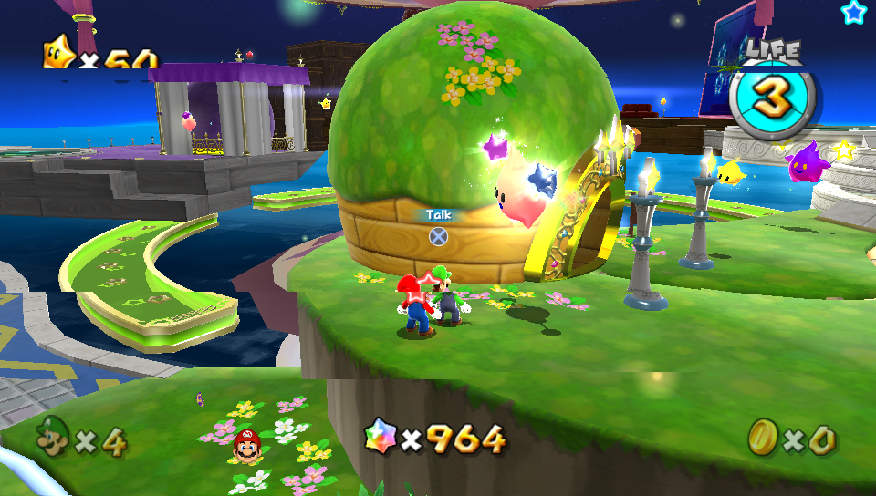
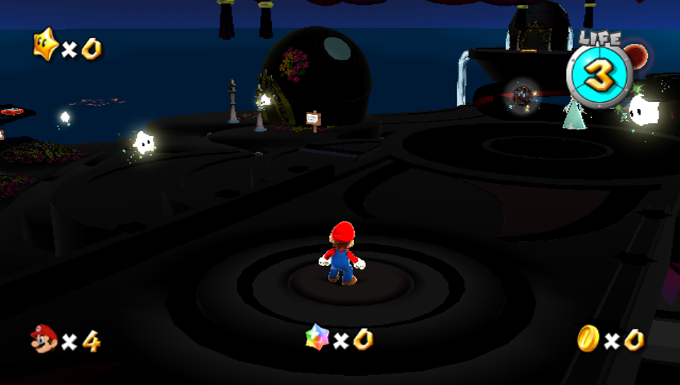

# Super Mario Galaxy for PS Vita — Version 3.0.1

**The full Nintendo Wii classic running natively on PlayStation Vita — now with smooth analog right-stick Free Camera, full-resolution 60 FPS across most of the game, and the first-ever Super Mario Galaxy multiplayer for local and online play.**

No emulator, no PC streaming, no compromises on portability: Super Mario Galaxy's own code runs directly on the PS Vita's ARM CPU and GPU, rebuilt from the ground up for handheld controls — smooth right-stick Free Camera, touch screen Wii pointer, optional rear-touch Star Bit aiming, motion-sensor (or stick) tilt steering, and instant button spin.

**[Download Version 3.0.1](https://github.com/CBOC-Vita-Lab/galaxy-vita/releases/latest)** · [3.0 Showcase & Release Notes](docs/RELEASE-3.0.md) · [Multiplayer Guide](docs/MULTIPLAYER.md) · [Install Guide](MANUAL-INSTALL.md) · [Controls](CONTROLS.md) · [Full Changelog](CHANGELOG.md)

> You'll need your own legally dumped copy of Super Mario Galaxy (Wii, USA, `RMGE01`). **Upgrading from 2.x or 3.0?** Just install the new VPK over your existing install — your saves, settings, and shader cache stay intact, and 3.0.1 stays fully cross-compatible with 3.0 multiplayer.

---

## Highlights Since Version 2.0

Version 3.0 is a generational leap over 2.0 — faster, sharper, rock-solid, and playable with friends for the very first time:

### 1. First-Ever Super Mario Galaxy Multiplayer (Local & Online-Ready)

* **Play Together (2–4 Players):** Explore the entire adventure side by side in a shared galaxy. Switches, Star Bits, purple coins, enemies, and Power Stars count for the whole team — and if someone falls, a **rescue bubble** floats them smoothly back to a teammate with a live follow camera.
* **Star Race (2–4 Players):** Go head-to-head for the same Power Star from a synchronized countdown, complete with live race timer, standings, series points, and automatic comeback handicaps so every race stays close.
* **Jump In With One Button:** Pick **Multiplayer** right after the title screen — no messy host/join setup. Friends on the **same Wi-Fi** appear automatically as 3D character faces on the gathering screen; press **START** and fly out together. Also built with **Nearby** (console-to-console, no router), **Far-Away Friend Codes**, and live **Online Play** on **`https://galaxy.psvita.dev`** (**Play with Anyone**, **Friends**, **Star Race Leaderboards**, and Cloudflare TURN relay).
* **6 Playable Characters & Chat:** Play as **Mario, Luigi, Toad, Yellow Toad, Cosmic Mario, or Cosmic Luigi**, with quick messages and typed chat.
* **Built Smooth & Safe:** Encrypted sessions, smooth remote character motion, automatic drop-in reconnection (up to 75 seconds), and dedicated **Team Files** so your single-player save is never touched unless you explicitly choose to share it.

### 2. Full-Resolution 60 FPS Across Most Gameplay — Plus Hardware 2× MSAA Quality Mode
* **Full Native Resolution (`960×544`) at 60 FPS:** Major GPU, shader, and CPU breakthroughs since 2.0 push most of the game to crisp **native resolution at 58–60 FPS** — including demanding favorites like **Honeyhive (59.9 FPS native)**, **Good Egg**, **Gusty Garden**, **Beach Bowl**, **Melty Molten (55–59.6 FPS)**, and **2-player Flipswitch (60.0 FPS)**. (Back in v1.2, Honeyhive ran at 12 FPS.)
* **Zero Uneven 48–50 FPS Stutter:** Performance mode now locks cleanly to **even 60 FPS** — and if an ultra-heavy overlook or busy 2-player planet can't hold 60, it transitions smoothly to a **locked, even 30 FPS** instead of choppy 45–50 FPS judder, then automatically returns to 60 as soon as headroom opens up.
* **New Quality Mode (`30 FPS` + Hardware `2× MSAA`):** Want the sharpest possible image on the Vita's OLED/LCD screen? Switch to **Full Detail (Quality)** for a rock-solid **30 FPS** at native **`960×544`** with **hardware `2× MSAA` anti-aliasing** and crisp anisotropic filtering.

### 3. Instant First-Boot Shader Loading (Zero Mid-Game Stutter)
* **5,401 Native PS Vita Shaders Precompiled Ahead of Time:** Harvested directly on real PS Vita hardware across every galaxy, midpoint, boss fight, all 7 power-ups, multiplayer menus/puppets, and Settings.
* **~0.4-Second RAM Preload:** All 5,401 shaders load straight into memory in **0.4 seconds** at startup. In cold first-boot tests from an empty cache, Title, Comet Observatory, Good Egg, Honeyhive, Beach Bowl, Melty Molten, and Dreadnought all ran with **zero shader-compile freezes**.

### 4. Over 30 Major Crash, Visual, Audio, Control & Multiplayer Fixes Since 2.0
Every single pain point from earlier releases has been hunted down and squashed across versions 2.1 through 3.0:

#### Crashes & Freezes Fixed
* **Bee Mushroom & Power-Up Transformation Crashes:** Grabbing a Bee Mushroom, Ice Flower, Spring Mushroom, Rainbow Star, or taking an electric shock no longer crashes Mario or Luigi when switching bodies.
* **No More Wasted Power-Ups:** If a form's models aren't loaded yet, touching the power-up leaves it intact instead of consuming it with no effect.
* **Comet Observatory & Kitchen Dome Crashes:** Fixed the graphics-memory lifetime bug that caused crashes entering the Observatory and Kitchen Dome.
* **Loading-Screen Hangs & Resolution-Switch Crashes:** Fixed infinite black screens when loading galaxies in Performance mode and crashes triggered by picture-size changes right after a stage load.
* **Cleaner Boot Diagnostics:** Fixed false "Taking longer than usual" stall messages while shaders are actively compiling, and added automatic crash details (`log.txt` + `psp2dmp`) if the game ever exits unexpectedly.

#### Visual & Graphics Fixes
* **Black-Hole Flicker & Crosshair Glitch:** Fixed white flashing and crosshair artifacts while Mario is pulled into a black hole.
* **Missing Fog & Swapped Object Textures:** Fixed shader fog-slot alignment so fog and materials render reliably on every console.
* **Blinking Ground Shadows:** Stabilized Mario's shadow on small planets and Dreadnought's starting disc.
* **No Vanishing Objectives:** Distant Bunnies, Toads, Rosalina, Lumas, switches, and bosses are guaranteed to stay visible in Performance mode.
* **Bad Precompiled Shader Glitches (2.1):** Removed misplaced-object shader bugs — all 5,401 shaders in 3.0 are compiled directly on real PS Vita hardware.
* **Upgraded Home Screen Bubble, LiveArea & Launch Splash (`content-rev 5`):** Refreshed 8-bit palette artwork built specifically for the PS Vita's LiveArea and circular Home icon.

#### Stutter, Audio & Engine Fixes
* **20-Second Micro-Hitch Eliminated:** Fixed the periodic "little stutter here and there" by spreading thread checks smoothly across frames.
* **48 FPS Lock & 50 FPS Judder Eliminated:** Removed the old pacing cap that trapped stages like Beach Bowl at 48 FPS, and replaced uneven 45–52 FPS stutter with clean even 60 / locked even 30 transitions.
* **Music Cutouts During Loading Fixed:** Large memory-card reads are now chunked so background music streams never pause behind archive loads.
* **Resolution-Switch & Menu Stutters Gone:** Next picture sizes are pre-allocated (~1 ms swap instead of a visible skip) and menus pre-warm at startup.
* **Major Engine Speed-Ups:** Split branchless vertex shaders, half-precision fog, exact 1-byte intensity textures, fast ARMv7 geometry welding, `4×` faster CPU texture swizzling, fewer shadow/water/heat-haze GPU passes, direct-to-screen presentation, `8–10 MiB` extra free VRAM in Honeyhive, quieter card logging, faster startup, and a freshly recorded 8-route CPU PGO profile.

#### Controls, Camera, Saves & Console Polish
* **Automatic Left-Stick Fallback for Dead Motion Sensors:** On Manta Surfing and Star Ball levels, Vitas with unresponsive motion sensors now switch seamlessly to left-stick steering automatically.
* **Zoomed-In Off-Screen Pull Stars & Star Bits Fixed:** At `1.5×` zoom, nearby coins, Star Bits, Launch Stars, and Pull Stars just outside the frame stay active — and the camera eases smoothly to `1.0×` when aiming at Pull Stars or entering fixed dome shots.
* **Galaxy Map Edge Targeting Fixed:** Bowser's planet and other edge planets can now be pointed at wherever their disc is visible on screen.
* **"Controller Disconnected" Settings Lockup Fixed:** Settings falls back cleanly to direct Vita button reads if a pad query hiccups.
* **Built-In Settings & Auto Language:** Settings now lives directly inside the game (start screen & **△** in pause) with a clean 2-mode Picture choice, automatic Vita system language detection (English, French, Spanish, German, Italian), and one-tap **Save and Start Again**.
* **Safe Saves Always On & OLED-Safe Keep-Awake:** Atomic temp-file saving with automatic `.mpbak` backups protects single-player and Team Files from power loss or crashes, and OLED-safe keep-awake prevents screen dimming mid-session.

#### Multiplayer Polish (Hardware Verified on PS Vita)
* **Smooth Remote Character Motion:** Hardened pose interpolation, velocity-matched gliding, and 30 FPS puppet animation remove jumpy remote movement.
* **Zero Fly-In Pushing:** Players no longer bump each other off the starting platform when flying into a galaxy.
* **Full Luigi Body on Face-First Fly-Ins:** Fixed partial/missing Luigi body rendering during launch-ring entrances.
* **Bubble Rescue Follow Camera & Anti-Double-Death:** The camera now smoothly tracks you while floating in a rescue bubble until a teammate pops you free, and clears leftover death-zone hits on pop.
* **Multiplayer Pause Zoom, Faster Gathering & Reconnect Hardening:** Restored camera zoom (`L`/`R`) in the MP pause menu, sped up the gathering screen, hardened group-restart synchronization, and added encrypted sessions with up to 75-second silent-link reconnection.

---

## Performance at a Glance (Real PS Vita Hardware)

Measured on a real PS Vita overclocked to **500 MHz CPU / 222 MHz GPU / 222 MHz BUS** with **PSVshell** and the 4th CPU core unlocked via **CapUnlocker**:

| Mode / Galaxy | Frame Rate & Resolution |
|---|---|
| **Good Egg, Gusty Garden, Freezeflame, Battlerock, Space Junk, Toy Time, Sea Slide, Bowser Jr.** | **58–60 FPS** at native `960×544` |
| **Honeyhive Galaxy** | **59.9 FPS native** at `960×544` (`100%` frame pacing) |
| **Beach Bowl & Melty Molten Galaxy** | **55–60 FPS** at `960×544` |
| **Dreadnought & Final Bowser Fight** | **55–60 FPS** in normal play; clean **locked 30 FPS** on the heaviest overlooks |
| **Multiplayer (2P Wi-Fi)** | **60.0 FPS** on compact galaxies (Flipswitch); clean **locked 30 FPS** on heavy open planets (Good Egg) |
| **Quality Mode (Full Detail)** | **Locked 30.0 FPS** at native **`960×544` with hardware `2× MSAA`** (Dreadnought, Melty Molten, etc.) |
| **First-Boot Shader Load** | **5,401 shaders preloaded in ~0.4 s** (`0` cold compiles across tested galaxies) |
| **Download / Install Size** | **~13.6 MB** VPK (~2.5 GB on memory card with your prepared game files) |

> **Recommended for Best 60 FPS Performance:** While Galaxy runs out of the box with zero extra plug-ins, we strongly recommend installing two standard Vita plug-ins:
> * **CapUnlocker (`capunlocker.skprx`)** — unlocks the PS Vita's 4th CPU core so sound, animation, and graphics work run across all four cores.
> * **PSVshell / PSVshellPlus** (or your preferred Vita overclock plug-in) — set **500 MHz CPU / 222 MHz GPU / 222 MHz BUS** (Galaxy automatically detects and keeps your 500 MHz overclock profile).

Full benchmark tables and camera-zoom comparisons are in [Performance](docs/PERFORMANCE.md).

---

## Multiplayer Status & Transparency

Multiplayer is brand-new in 3.0 and has been **live-tested on a real PS Vita** over Wi-Fi (5–16 ms ping: menus, gathering screen, fly-in, co-op play, smooth remote movement, full Luigi fly-in, bubble-follow rescue camera, checkpoints, even 60/30 pacing, and clean leaving all passed on hardware).

* **Local Wi-Fi, Nearby (no router), Far-Away Codes, and Online Play (`https://galaxy.psvita.dev`)** are all live in 3.0.
* **Good to know:** Two physical Vitas together, Nearby (ad-hoc), far-away codes across real routers, live online sessions from a console, and 4-player console stress tests have only been tested on computers so far — see [Known Issues](KNOWN-ISSUES.md) and [Multiplayer](docs/MULTIPLAYER.md) for full details.
* Your single-player save stays completely separate in Team Files unless you choose **Play This File** (which backs up first); we still recommend backing up `ux0:data/smg/saves` before your first multiplayer session.

---

## Built for the PS Vita

Galaxy was designed around the Wii Remote pointer, so the Vita controls were crafted with extra care:

* **Front Touch Screen:** Tap anywhere to collect Star Bits, talk, navigate menus, or hold on a **Pull Star** to grapple across space.
* **Rear Touch Pad (Optional):** Slide a finger on the back pad like a laptop trackpad to aim the Star Bit pointer while keeping your thumbs on the sticks and face buttons (resting fingers are ignored). Enable anytime via **△ Settings**.
* **Tilt Steering (with Auto Stick Fallback):** Tilt your Vita to surf the Manta Ray or roll the Star Ball (`Select` re-centers). Broken motion sensor? The game automatically hands steering to the left stick (or pick Left Stick anytime in Controls).
* **Effortless Buttons:** Spin with **Square** or **R**, shoot Star Bits with **Circle**, crouch/ground-pound with **L**, and adjust camera zoom (`1.0×` to `2.0×`) right inside the pause menu.

| Button | Action |
|---|---|
| **Left Stick** | Move Mario / Luigi |
| **Cross (×)** | Jump |
| **Square (□)** or **R** | Spin |
| **L** | Crouch / Ground Pound |
| **Circle (○)** | Shoot Star Bit at pointer |
| **Right Stick** | Camera (or aim pointer) |
| **Triangle (△)** | Center camera behind player (in pause menu: open **Settings**) |
| **Touch Screen** | Point, grab Star Bits, select, hold to grab Pull Stars |
| **Rear Touch** *(optional)* | Trackpad-style Star Bit aiming |
| **START** | Pause (`L`/`R` for camera zoom, `△` for Settings) |

Full control options and remapping guide: [Controls](CONTROLS.md).

---

## Install in Minutes

**What you need:** A homebrew-enabled PS Vita (VitaShell), ~2.5 GB free space, your own Super Mario Galaxy Wii USA (`RMGE01`) disc image, and `libshacccg.suprx` installed once on your Vita.

**Strongly recommended for full 60 FPS:** Install **CapUnlocker** (unlocks the Vita's 4th CPU core) and **PSVshell / PSVshellPlus** (overclock to **500 MHz CPU / 222 MHz GPU / 222 MHz BUS** — Galaxy leaves your 500 MHz profile untouched automatically).

### Option 1: CBOC Vita Installer (Recommended)
Open **[CBOC Vita Installer](https://github.com/CBOC-Vita-Lab/vita-installer/releases/latest)**, select **Super Mario Galaxy**, pick your disc image, and click **Install**. It prepares your game files and transfers everything to your Vita over Wi-Fi or USB automatically. ([Desktop Installer Guide](EASY-INSTALL.md))

### Option 2: Manual Install
1. Download `Galaxy-Vita.vpk` from the **[latest release](https://github.com/CBOC-Vita-Lab/galaxy-vita/releases/latest)**.
2. Extract and prepare your disc files ([Prepare Your Game](MANUAL-PREPARE-GAME.md) — shrinking cutscene videos is optional and saves card space).
3. Copy the prepared files to `ux0:data/smg/game/` and copy `Galaxy-Vita.vpk` to your Vita.
4. Install the VPK in **VitaShell** and launch from the LiveArea.

**Updating from 2.x?** Install the 3.0 VPK right over your old one — your saves, settings, and game files stay untouched. If the Vita Home Screen still shows the old bubble or Settings tile, run **Refresh LiveArea** in VitaShell.

---

## Download Contents & Developer Docs

| File / Doc | Description |
|---|---|
| `Galaxy-Vita.vpk` | Complete PS Vita application (~13.6 MB) including the 5,401-shader native seed pack. |
| [3.0 Release Showcase](docs/RELEASE-3.0.md) | Visual tour of everything new in Version 3.0. |
| [Multiplayer Guide](docs/MULTIPLAYER.md) | Quick-start guide for Play Together, Star Race, Wi-Fi, Nearby, Codes & Online. |
| [Known Issues](KNOWN-ISSUES.md) | Honest list of open items and untested console paths. |
| [Building from Source](docs/BUILDING.md) | How to compile the VPK yourself (`decomp/`, `vita/`, `platform/vgx/`). |
| [Technical Notes](docs/TECHNICAL.md) · [Source Record](docs/SOURCE.md) | Renderer architecture, runtime switches, and verified build records. |
| [Verify Your Download](docs/CHECK-DOWNLOAD.md) | Check every file against `SHA256SUMS`. |

## Credits

Created by **CBOC Vita** (AI-assisted engineering directed and hardware-tested on real PS Vita consoles), building on the shoulders of the **[Petari](https://github.com/SMGCommunity/Petari)** decompilation project, GalaxyQuest, vitaGL, and the PlayStation Vita homebrew community. See [Credits](CREDITS.md) and [Privacy](docs/PRIVACY.md).

*An unofficial fan port, not affiliated with Nintendo or Sony. You must own a legal copy of Super Mario Galaxy.*
