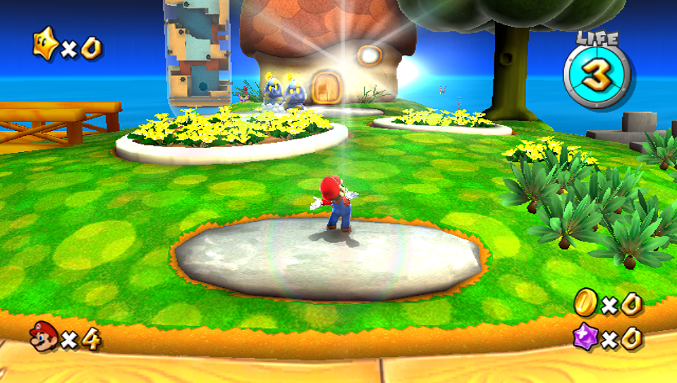
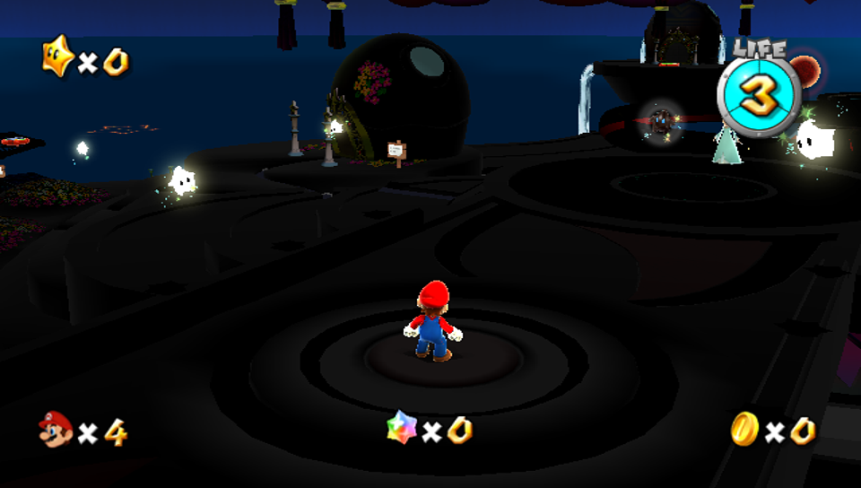

# Super Mario Galaxy Vita

This is Super Mario Galaxy running natively on a PS Vita. There's no emulator and no streaming involved: the game itself
was rebuilt to run on the Vita's own processor and graphics chip. We haven't found anyone who has run Galaxy on the Vita
before, so as far as we know this is a first.

Boot it up and you land in the Comet Observatory with Rosalina's music playing, holding the whole game in your hands. And it plays like it was made for the Vita: slide a finger on the rear touch pad to
aim Star Bits, touch the screen where you used to point the Wii Remote, and tilt the Vita to roll the Star Ball.

**[Download the latest version](https://github.com/CBOC-Vita-Lab/galaxy-vita/releases/latest)** · [Install guide](INSTALL.md) · [Controls](CONTROLS.md) · [What's in 1.0](CHANGELOG.md)

You'll need your own copy of the game (Wii, USA, `RMGE01`).

## Touch Controls, Built For The Vita

Galaxy was made for the Wii pointer, so touch got more work than anything else in this port.

- **Rear touch Star Bit aiming.** The feature people asked for most. Slide a finger on the back pad and the Star Bit
  pointer glides across the screen like a laptop trackpad, while your thumbs stay on the sticks and buttons. Fingers that
  are just holding the Vita are ignored. Turn it on in the pause menu with Triangle.
- **The front screen is your Wii pointer.** Touch anywhere and Star Bits fly to you. Tap to talk, open and choose, and hold
  a finger still to grab a Pull Star.
- **Tilt to steer.** The Star Ball and Manta-ray levels steer by tilting the Vita. Wherever you hold it counts as level, and
  Select re-centers it.
- **Buttons where the Wii used motion.** Spin with Square or R instead of shaking a remote, and shoot Star Bits with Circle.
- **Settings in the pause menu.** A panel in the game's own style: L and R set the camera zoom (1.0× to 2.0×), Triangle
  turns rear touch aiming on or off.

The full list is in [Controls](CONTROLS.md).

## How Smooth Is It?

Frames per second (fps) is how many new pictures you see each second. 60 is the most the Vita's screen can show, and many
console games aim for 30. Measured with this exact version on a PS Vita, in scripted 2½-minute runs of running, jumping,
triple jumps, spins, camera turns and pauses:

| | |
|---|---|
| **Good Egg Galaxy** | **51 fps** on average (41 at its lowest, 56 at its highest) |
| **Comet Observatory**, the busiest place in the game | **43 fps** on average (32 lowest, 55 highest) |
| **Quiet moments and menus** | a full **60 fps** |
| **Stutters longer than a tenth of a second while playing** | **0** |
| **Game speed** | Full speed: the game keeps its 60 updates a second. When a moment is too busy, a picture is skipped instead of the game slowing down. |
| **Sharpness** | 640×456 up to the Vita's full 960×544 with anti-aliasing, chosen automatically. It only changes during pauses and fades, so it never hitches mid-jump. |
| **Graphics effects compiled ahead of time** | 1,131, so new effects don't pause the game |
| **Download** | about 6 MB (2.5 GB on the memory card with your game files) |

(The lowest and highest numbers are averages over 5-second stretches.)

## The Game

Bowser has taken Princess Peach and the Power Stars, and Mario heads into space to get them back. From Rosalina's Comet
Observatory you fly out to dozens of galaxies: planets small enough to run around in seconds, gravity that changes under your
feet, Star Bits everywhere, the Bee, Boo and Spring suits, and some huge boss fights. 120 Power Stars in all. Plenty of people
call it one of the best games ever made, and it plays wonderfully on a handheld.

## How It Works

- **It runs natively.** A Wii emulator would need far more power than the Vita has. Instead, the game's own code, from the
  community's [Petari](https://github.com/SMGCommunity/Petari) decompilation, is compiled for the Vita's ARM processor.
- **It has its own graphics engine.** The Wii's graphics commands are translated for the Vita's GPU as the game runs, and the
  work is shared across all three of the Vita's CPU cores.
- **It keeps full game speed.** The game runs its 60 steps a second. If a moment is too busy to draw every frame, a
  frame is skipped rather than the game slowing down.

## What's In Version 1.0

- **Rear touch Star Bit aiming, front touch pointing and tilt steering** (above).
- **Smooth play, without the hitches.** The picture quality adjusts itself to what each scene can handle, and it saves those changes for pauses and screen fades instead of the middle of a jump. Each galaxy remembers its best setting for next time.
- **Sharper picture.** The game renders above the Wii's resolution wherever the Vita has room, up to the screen's full 960×544, with anti-aliased edges when there's GPU to spare.
- **Optional HD Mario and friends.** Turn your own game files into sharper Mario, Luigi, Peach, Rosalina, Lumas, Toads, Bowser, Bowser Jr., Power Stars, launch stars and power-ups, made for the Vita screen. [How](tools/hdtex/README.md).
- **Vita button prompts.** The game's own text shows Cross, Circle, Triangle, Square, L and START instead of Wii buttons.
- **The whole game,** with its menus, storybook, movies, music and normal in-game saves.

First launch takes a little longer while the graphics are prepared. See [Known Issues](KNOWN-ISSUES.md) for what's still being worked on.

## Install

**You need:** a PS Vita with homebrew (VitaShell), about 2.5 GB free, your own Super Mario Galaxy disc image (Wii, USA, `RMGE01`), and `libshacccg.suprx` set up on the Vita (most homebrew-ready Vitas already have it).

### Easy way: CBOC Vita Installer

Open [CBOC Vita Installer](https://github.com/CBOC-Vita-Lab/vita-installer/releases/latest), pick Super Mario Galaxy, choose your disc image, and press Install. It prepares the game files and sends everything to your Vita over Wi-Fi or USB. [Desktop guide](DESKTOP-INSTALL.md)

### Manual way

1. Download `Galaxy-Vita.vpk` from the [latest release](https://github.com/CBOC-Vita-Lab/galaxy-vita/releases/latest).
2. Prepare your game files from your disc image ([Prepare your game](PREPARE-GAME.md)).
3. Copy them to `ux0:data/smg/game/`, and copy the VPK to your Vita.
4. Install the VPK in VitaShell and launch the bubble.

**Updating?** Just install the new VPK over the old one. Your saves and settings stay.

## Playing

| Button | Action |
|---|---|
| **Left stick** | Move |
| **Cross** | Jump |
| **Square** or **R** | Spin |
| **L** | Crouch / ground pound |
| **Circle** | Shoot a Star Bit at the pointer (the right stick aims it) |
| **Right stick** | Camera |
| **Triangle** | Camera behind Mario |
| **Touch screen** | Point, collect Star Bits, choose; hold still to grab a Pull Star |
| **Rear touch** (optional) | Slide to aim the pointer |
| **START** | Pause |

**In the pause menu:** L and R set the camera zoom, and Triangle turns rear touch aiming on or off. Your choices are saved for next time. The full list is in [Controls](CONTROLS.md).

## Download Contents

| File | What it is |
|---|---|
| `Galaxy-Vita.vpk` | The game app for your Vita. Install it in VitaShell. |
| `Galaxy-Vita-install.zip` | The VPK plus the guides, the game-preparation tools, checksums and the full source. |

## For Developers

| | |
|---|---|
| [Building](docs/BUILDING.md) | Build the VPK from source |
| [Technical notes](docs/TECHNICAL.md) | The renderer, the runtime switches, and the engineering notes for each version |
| [Source record](docs/SOURCE.md) | What each release was built from |
| [Check the download](docs/CHECK-DOWNLOAD.md) | Verify the files against `SHA256SUMS` |

The game code (the Petari decompilation) is in `decomp/`, the Vita runtime in `vita/`, and the GX renderer in `platform/vgx/`.

## Credits

Built by AI agents (Claude), and directed and play-tested on real hardware by a human. It stands on the work of the [Petari](https://github.com/SMGCommunity/Petari) decompilation project, GalaxyQuest, vitaGL and the Vita homebrew community. See [Credits](CREDITS.md).

An unofficial fan project, not affiliated with Nintendo or Sony. You must own the game.
