# Super Mario Galaxy for PS Vita 3.0 — Full-Res 60 FPS & First-Ever Multiplayer

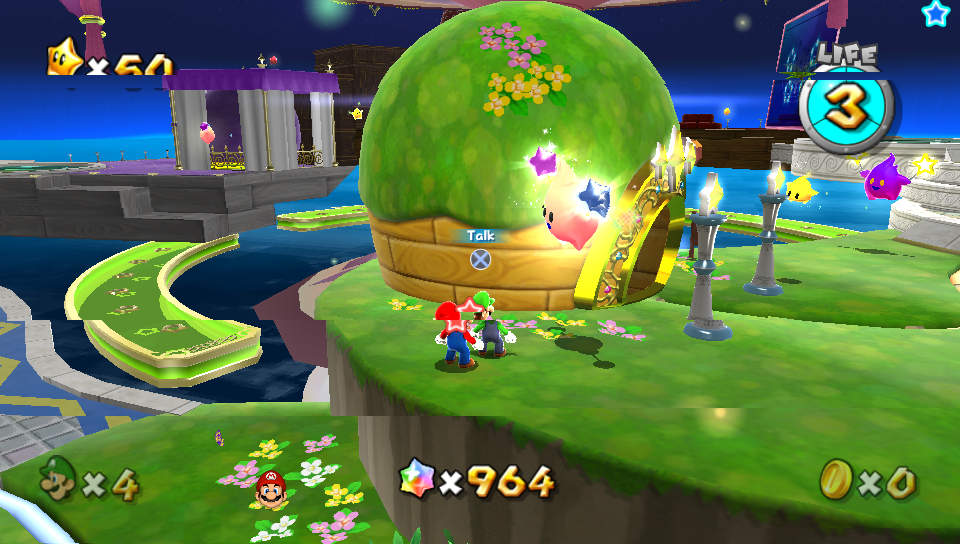

**Version 3.0 is the biggest leap since Super Mario Galaxy first landed on PlayStation Vita.** Compared to 2.0, almost the entire adventure now runs at **full native resolution (`960×544`) at up to 60 FPS**, **Quality mode gains hardware `2× MSAA`**, **5,401 precompiled shaders** eliminate first-visit stutters, and — for the very first time anywhere on Vita — **Super Mario Galaxy has full 2–4 player Multiplayer** built for both local and online play.

> You still need your own Super Mario Galaxy Wii USA (`RMGE01`) disc files. **Upgrading from 2.x?** Install `Galaxy-Vita.vpk` right over your current install — your saves, settings, and game files stay safe.

---

## First-Ever Super Mario Galaxy Multiplayer (Local & Online-Ready)

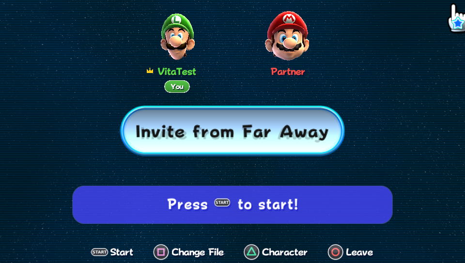

* **Play Together (2–4 Players):** Team up in one shared galaxy where switches, Star Bits, purple coins, enemies, and Power Stars count for everyone. Fall off a planet and a **rescue bubble** floats you smoothly right back to a teammate — with a live follow camera tracking you all the way until they pop you free.
* **Star Race (2–4 Players):** Race head-to-head to the same Power Star from a synchronized countdown, complete with an on-screen timer, live standings, series leaderboard points, and automatic winner start delays so every rematch stays intense.
* **Zero Setup Hassle:** Choose **Multiplayer** right after the title screen. Every player on your **same Wi-Fi** pops onto the gathering screen as a 3D face — no host/join menus, just press **START**. Also built with **Nearby** (direct console-to-console, no router), **Far-Away Friend Codes**, and live **Online Play** on **`https://galaxy.psvita.dev`** (**Play with Anyone**, **Friends**, **Star Race Leaderboards**, and Cloudflare TURN relay).

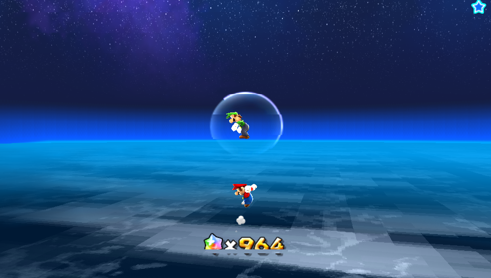

* **Six Playable Characters:** Mario, Luigi, Toad, Yellow Toad, Cosmic Mario, and Cosmic Luigi — plus quick messages and typed chat (with per-player mute).
* **Polished on Real Hardware:** Smooth remote player movement, zero pushing during galaxy fly-ins, full Luigi rendering on face-first launch rings, encrypted sessions, automatic reconnection (up to 75 s), and clean **even 60 / even 30** frame pacing (60.0 FPS on Flipswitch, locked 30 on busy open planets like Good Egg).
* **Your Single-Player Save Stays Protected:** Multiplayer uses its own **Team Files** and creates an automatic checked Safe Copy on first launch.

*(Hardware status: live 2-player Play Together over Wi-Fi verified on a real PS Vita at 5–16 ms ping, and the public online server `https://galaxy.psvita.dev` is live with TURN relay, WAF, and rate limiting active. Two physical Vitas, Nearby ad-hoc, far-away codes across real routers, and 4-player console stress tests have only been tested on computers so far — see [Known Issues](https://github.com/CBOC-Vita-Lab/galaxy-vita/blob/v3.0/KNOWN-ISSUES.md).)*

---

## Full-Resolution 60 FPS & Hardware 2× MSAA Quality Mode

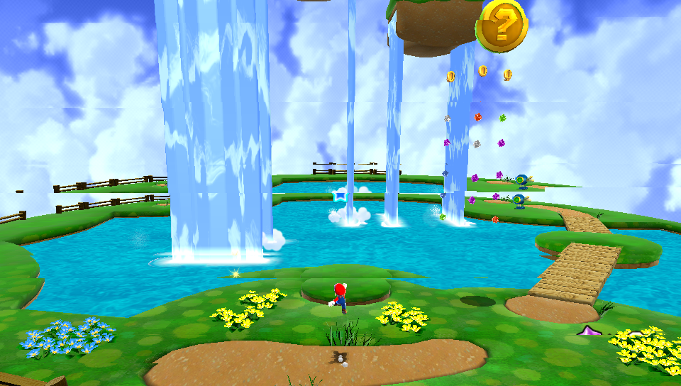

A massive GPU, shader, and CPU overhaul since Version 2.0 delivers both higher frame rates and sharper visuals on real PS Vita hardware (measured at **500 MHz CPU / 222 MHz GPU / 222 MHz BUS** via **PSVshell** with the 4th CPU core unlocked via **CapUnlocker**):

| Mode / Galaxy | Version 3.0 (Real PS Vita) |
|---|---|
| **Good Egg, Gusty Garden, Freezeflame, Battlerock, Space Junk, Toy Time, Sea Slide, Bowser Jr.** | **58–60 FPS** at native `960×544` |
| **Honeyhive Galaxy** | **59.9 FPS native** at `960×544` (`100%` frame cadence — up from 12 FPS in v1.2!) |
| **Beach Bowl & Melty Molten Galaxy** | **55–60 FPS** at `960×544` (Melty Molten up to `59.6 FPS` steady!) |
| **Dreadnought & Final Bowser Fight** | **55–60 FPS** in normal play; clean **locked even 30 FPS** on the heaviest overlooks |
| **Quality Mode (Full Detail)** | **Locked 30.0 FPS** at native **`960×544` with hardware `2× MSAA`** & anisotropic filtering |

* **No More Choppy 48–50 FPS Judder:** Performance mode locks cleanly to **even 60 FPS**, and only steps down to a **silky-even 30 FPS** during sustained heavy scenes — automatically stepping right back up to 60 as soon as the action clears.
* **Under-the-Hood Horsepower:** Major shader optimizations (split branchless vertex shaders, half-precision fog, early alpha-test, projective UV cuts), exact 1-byte intensity textures, fast ARMv7 geometry welding, `4×` faster CPU texture swizzling, vitaGL fast-path upgrades, and a freshly recorded **CPU PGO profile** squeeze dramatically more speed out of the Vita without changing the look of the game.
* **Instant Shader Loading (5,401 Precompiled Shaders):** Every galaxy, boss fight, power-up, multiplayer screen, and menu was harvested natively on a real PS Vita. All **5,401 shaders preload into RAM in ~0.4 seconds** — giving **zero cold shader compiles** across Title, Observatory, Good Egg, Honeyhive, Beach Bowl, Melty Molten, and Dreadnought even on a brand-new install!

---

## All Major Bug Fixes & Quality-of-Life Upgrades Since 2.0

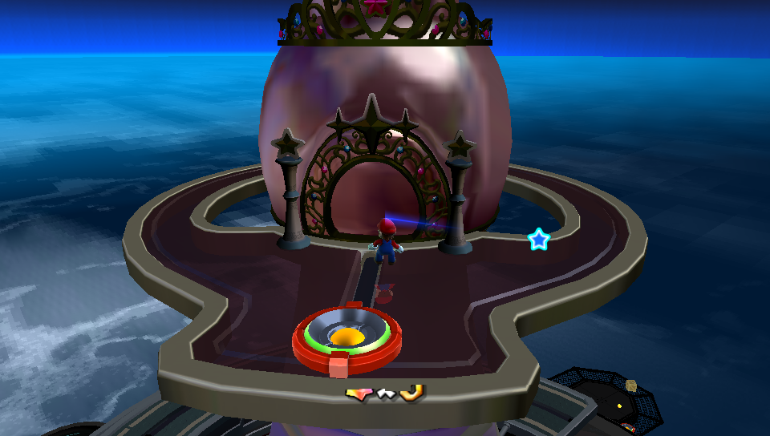

More than **30 major crash, visual, audio, control, save, and multiplayer fixes** have landed between Version 2.0 and Version 3.0:

### Crashes & Stability
* **Bee Mushroom & power-up transformation crashes fixed:** Grabbing a Bee Mushroom, Ice Flower, Spring Mushroom, Rainbow Star, or getting shocked by an electric enemy no longer crashes Mario or Luigi mid-morph.
* **Power-ups are never lost** if a form's models aren't loaded yet — the item stays put instead of vanishing.
* **Comet Observatory & Kitchen Dome crashes fixed:** Resolved the GPU memory-free-while-drawing fault behind both crashes.
* **Performance-mode loading black-screen hang fixed:** Galaxies no longer stall indefinitely on a black screen during 60 FPS loads.
* **Post-load resolution-switch crash fixed** by resampling cleanly instead of reusing stale pre-load timings.
* **Boot stall watch & crash reports improved:** Eliminated false "Taking longer than usual" messages during active shader prep, and improved `log.txt` + `psp2dmp` diagnostics if an unexpected exit ever happens.

### Graphics & Visual Fixes
* **Black-hole white flicker & crosshair artifact fixed** while Mario is falling into a black hole.
* **Missing fog & corrupted object textures fixed** (locked shader fog slot alignment).
* **Blinking ground shadows fixed** on small planets and Dreadnought's start disc.
* **No vanishing objectives in Performance mode:** Distant Toads, Lumas, Rosalina, bunnies, switches, and bosses are always kept drawn.
* **Misplaced-object shader bugs from 2.1 completely gone:** All **5,401** shaders ship compiled directly on real PS Vita hardware.
* **Upgraded Home Screen bubble, LiveArea & launch splash (`content-rev 5`):** Refreshed 8-bit palette artwork tailored for the Vita Home Screen and Start gate.

### Stutter, Audio & Engine Fixes
* **20-second periodic micro-hitch ("little stutter here and there") eliminated** by spreading thread checks smoothly across frames.
* **48 FPS lock & uneven 50 FPS judder eliminated** in both single player and multiplayer.
* **Music cutouts during loading fixed:** Long memory-card archive reads are chunked into 512 KiB slices so audio streams never stall behind them.
* **Resolution-switch & menu stutters eliminated:** Next picture sizes are pre-allocated (~1 ms swap) and menus warm up at start-up.
* **Quieter memory-card logging & faster start-up:** Dropped constant 100 ms dev-stat card writes during play and trimmed boot overhead.

### Controls, Camera, Saves & Console Experience
* **Broken motion sensor auto-fallback:** On Manta Surfing and Star Ball levels, an unresponsive tilt sensor automatically hands control to the left stick.
* **Zoomed-in (`1.5×`) off-screen Pull Stars, Launch Stars, Coins & Star Bits fixed:** Nearby items just outside the zoomed view stay active, and the camera automatically eases back to `1.0×` for Pull Stars and fixed dome shots.
* **Bowser's planet on the Galaxy Map fixed:** Planets whose center sits off the screen edge can now be selected anywhere their disc is visible.
* **"Controller disconnected" Settings freeze fixed** with a clean fallback to direct Vita pad reads.
* **Settings moved inside the game:** Open from the Start screen or press **△** in pause — clean 2-mode Picture choice (**Smooth Motion 60 FPS** vs. **Full Detail 30 FPS 2× MSAA**), automatic Vita system language detection (**English, French, Spanish, German, Italian**), and one-tap **Save and Start Again**.
* **Safe Saves always on & OLED-safe keep-awake:** Power-cut-safe atomic saves with `.mpbak` backups protect both single-player saves and Team Files, and the screen stays cleanly awake during play.

### Multiplayer Fixes (Hardware Verified on PS Vita)
* **Smooth remote player movement** (velocity-matched glide + 30 FPS puppet animation cadence eliminate jumpy motion).
* **Zero fly-in pushing** so teammates never knock each other off the landing platform.
* **Full Luigi body on face-first launch-ring fly-ins** (fixed missing body segments).
* **Bubble rescue follow camera & anti-double-death fix** (camera tracks your bubble across the galaxy without overriding cutscenes, and clears leftover death hits when popped).
* **Multiplayer pause camera zoom (`L`/`R`) restored**, faster gathering screen, group-restart sync guards, encrypted sessions, and up to 75-second silent-link reconnection.

---

## Quick Update Guide

* **Installing or Updating:** Install `Galaxy-Vita.vpk` in VitaShell (or use **[CBOC Vita Installer](https://github.com/CBOC-Vita-Lab/vita-installer/releases/latest)**). Your saves, settings, and prepared game files stay intact. If LiveArea still shows the old icon or Settings tile, run **Refresh LiveArea** in VitaShell.
* **Strongly Recommended Plug-ins for Best 60 FPS Performance:** While Galaxy runs without extra plug-ins, we strongly recommend **CapUnlocker** (unlocks the Vita's 4th CPU core) together with **PSVshell / PSVshellPlus** (or your preferred overclock plug-in set to **500 MHz CPU / 222 MHz GPU / 222 MHz BUS** — Galaxy automatically respects your 500 MHz overclock profile).
* **Full Details:** See [What's New](https://github.com/CBOC-Vita-Lab/galaxy-vita/blob/v3.0/CHANGELOG.md) for every technical change, [Multiplayer Guide](https://github.com/CBOC-Vita-Lab/galaxy-vita/blob/v3.0/docs/MULTIPLAYER.md) to get started with friends, and [Known Issues](https://github.com/CBOC-Vita-Lab/galaxy-vita/blob/v3.0/KNOWN-ISSUES.md) for open items.

## Gallery (Straight from a PS Vita Running 3.0)

| | |
|---|---|
| 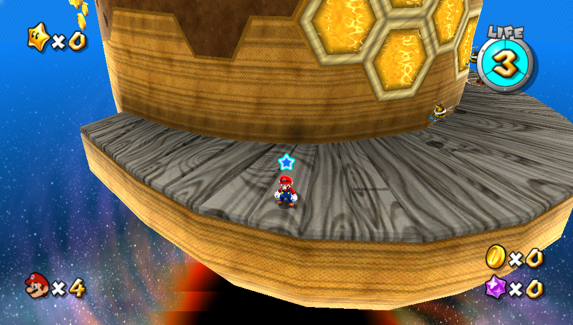 | 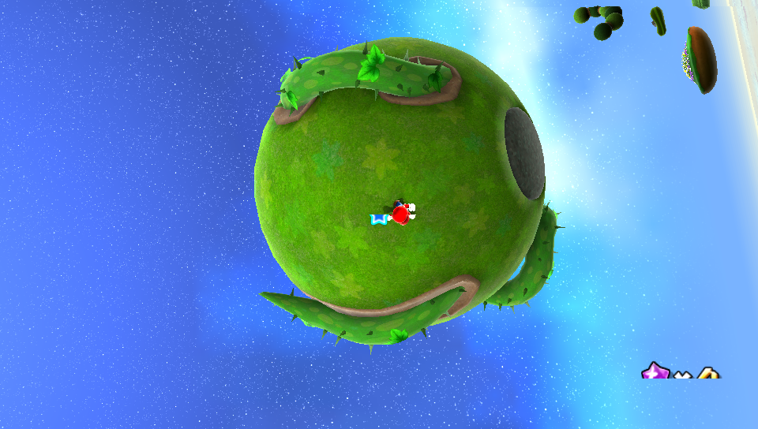 |
| 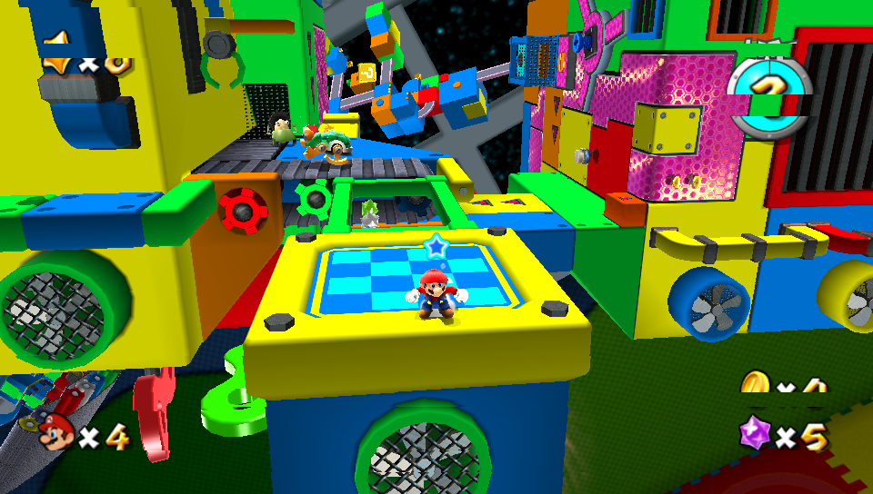 | 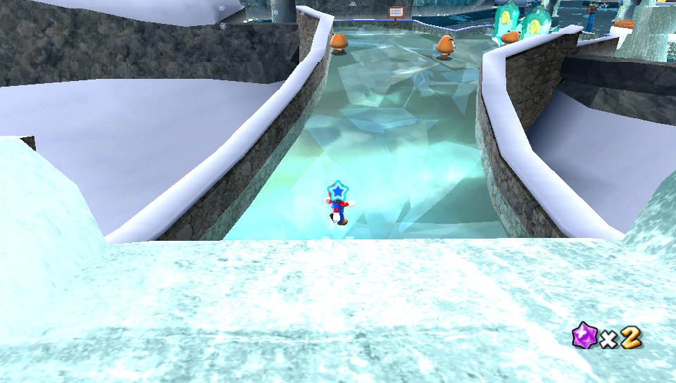 |
| 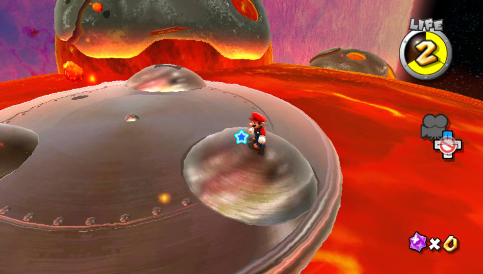 | 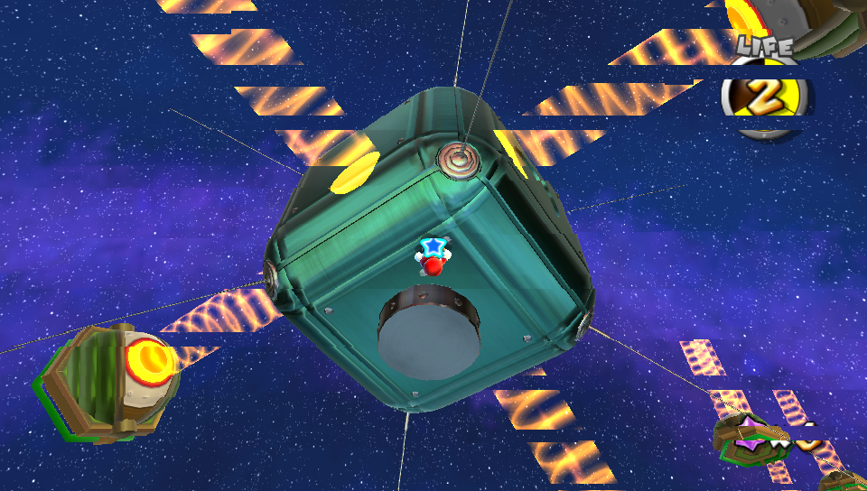 |

Thank you to everyone in the PS Vita community who tested, reported issues, and cheered this port on. Grab your Vita, grab a friend, and blast off! — **CBOC Vita**
